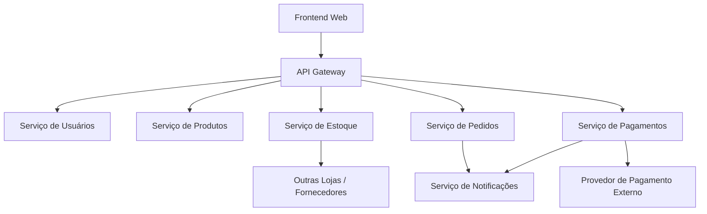
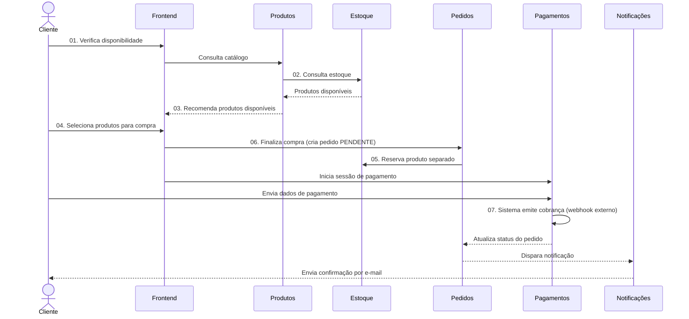
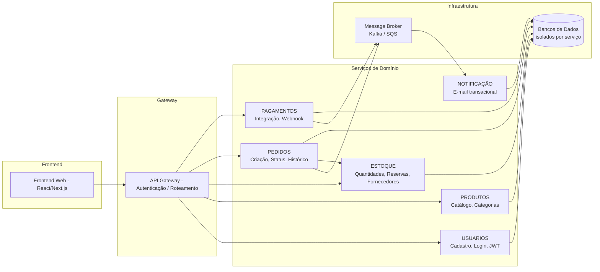

# Requisitos do Sistema — Plataforma E-Commerce com Microsserviços

## Resumo Executivo

Este documento descreve os requisitos funcionais e não funcionais da plataforma de E-Commerce baseada em arquitetura de microsserviços. O projeto visa substituir soluções monolíticas por uma arquitetura distribuída, resiliente e escalável, cobrindo os domínios de autenticação, catálogo, estoque, pedidos, pagamentos e notificações.

**Referências:** EXEMPLO.TXT, DOMAINSTORYTELLING.JPG  
**Concorrentes / Referências de mercado:** Shopify, VTEX, WooCommerce

---

## 1. Objetivo do Sistema

### 1.1 Propósito Principal
Prover uma plataforma de comércio eletrônico (e-commerce) modular, com alta disponibilidade e capacidade de escalonamento independente por domínio de negócio.

### 1.2 Problemas Resolvidos
- Indisponibilidade total causada por falha em módulo único (monólito)
- Dificuldade de manutenção e deploy independente por domínio
- Falta de escalabilidade horizontal por serviço

### 1.3 Usuários
| Perfil | Descrição |
|---|---|
| Cliente | Navega, seleciona produtos e realiza compras |
| Vendedor / Operador | Gerencia estoque, reservas e atendimento |
| Administrador | Gerencia catálogo, usuários e configurações |

---

## 2. Contexto Operacional

### 2.1 Proposta da Solução
Plataforma web de E-Commerce composta por microsserviços independentes, cada um com banco de dados próprio, APIs REST e integração por eventos assíncronos (event-driven).

### 2.2 Arquitetura de Alto Nível



### 2.3 Fluxo Principal — Domain Storytelling (Checkout)



### 2.4 Integrações Necessárias
- Provedor de pagamento externo (via webhook)
- Serviço de e-mail transacional (ex: Amazon SES, SendGrid)
- Fornecedores / outras lojas para consulta de estoque (fallback)

### 2.5 Restrições Identificadas
- Cada microsserviço deve ter banco de dados próprio (isolamento de dados)
- Comunicação entre serviços via eventos assíncronos onde possível
- API Gateway obrigatório como ponto único de entrada

---

## 3. Regras de Negócio

### 3.1 Processos Principais

| ID | Regra |
|---|---|
| RN-01 | Pedido só pode ser criado por cliente autenticado |
| RN-02 | Produto só pode ser adicionado ao pedido se houver estoque disponível |
| RN-03 | Reserva de estoque ocorre no momento da criação do pedido |
| RN-04 | Pedido permanece PENDENTE até confirmação do pagamento |
| RN-05 | Pagamento recusado mantém pedido PENDENTE e notifica cliente para nova tentativa |
| RN-06 | Pagamento aprovado atualiza pedido para CONFIRMADO e dispara notificação |
| RN-07 | Cancelamento de pedido libera reserva de estoque |
| RN-08 | Administrador pode atualizar catálogo e estoque independentemente |

### 3.2 Cenários BDD (Behavior Driven Development)

```gherkin
# Funcionalidade: Checkout com pagamento aprovado
Funcionalidade: Finalização de compra

  Cenário: Pedido concluído com sucesso
    Dado que o Cliente está autenticado
    E possui itens no carrinho com estoque disponível
    Quando o Cliente finalizar a compra
    E o pagamento for aprovado pelo provedor externo
    Então o Pedido deve ser atualizado para status CONFIRMADO
    E o estoque deve ser decrementado
    E o Cliente recebe um e-mail de confirmação

  Cenário: Pagamento recusado
    Dado que o Cliente iniciou o pagamento
    E o carrinho possui itens com estoque reservado
    Quando o provedor retornar FALHA NO PAGAMENTO
    Então o Pedido deve permanecer com status PENDENTE
    E o estoque reservado deve ser mantido por 15 minutos
    E o Cliente deve receber notificação de pagamento recusado
    E o Cliente deve ser orientado a atualizar a forma de pagamento

  Cenário: Produto sem estoque
    Dado que o Cliente está autenticado
    E tenta adicionar ao carrinho um produto sem estoque
    Quando o Serviço de Estoque retornar quantidade zero
    Então o sistema deve exibir mensagem de indisponibilidade
    E sugerir produtos similares disponíveis

  Cenário: Cancelamento de pedido
    Dado que o Cliente possui um pedido com status PENDENTE
    Quando o Cliente solicitar o cancelamento
    Então o pedido deve ser atualizado para CANCELADO
    E o estoque reservado deve ser liberado
    E o Cliente deve receber notificação de cancelamento
```

---

## 4. Requisitos Funcionais (User Stories)

### FUNC-01 — Cadastro de Usuário

| Campo | Descrição |
|---|---|
| **Identificador** | FUNC-01 |
| **Título** | Cadastro de usuário |
| **Descrição** | O sistema deve permitir que novos usuários se cadastrem informando nome, e-mail e senha |
| **Atores** | Cliente |
| **Pré-condições** | E-mail não cadastrado anteriormente |
| **Pós-condições** | Usuário criado e e-mail de boas-vindas enviado |
| **Fluxo principal** | 1. Usuário preenche formulário → 2. Sistema valida dados → 3. Cria conta → 4. Envia e-mail de confirmação |
| **Fluxos alternativos** | E-mail já cadastrado: exibe mensagem de erro e sugere recuperação de senha |
| **Regras de negócio** | RN-01 |
| **Critérios de aceite** | Conta criada com sucesso; e-mail de confirmação recebido em até 1 minuto |

---

### FUNC-02 — Autenticação de Usuário

| Campo | Descrição |
|---|---|
| **Identificador** | FUNC-02 |
| **Título** | Login e autenticação |
| **Descrição** | O sistema deve autenticar usuários via e-mail e senha, emitindo token JWT |
| **Atores** | Cliente, Administrador, Operador |
| **Pré-condições** | Usuário cadastrado e e-mail confirmado |
| **Pós-condições** | Token JWT emitido com tempo de expiração |
| **Fluxo principal** | 1. Usuário informa credenciais → 2. Sistema valida → 3. Emite JWT |
| **Fluxos alternativos** | Credenciais inválidas: incrementa contador de tentativas; após 5 tentativas bloqueia por 15 min |
| **Regras de negócio** | RN-01 |
| **Critérios de aceite** | Token JWT válido emitido; bloqueio após 5 tentativas falhas |

---

### FUNC-03 — Consulta de Catálogo de Produtos

| Campo | Descrição |
|---|---|
| **Identificador** | FUNC-03 |
| **Título** | Consulta e busca de produtos |
| **Descrição** | O sistema deve permitir busca, filtragem e visualização de produtos com disponibilidade de estoque |
| **Atores** | Cliente |
| **Pré-condições** | Nenhuma (acesso público) |
| **Pós-condições** | Lista de produtos exibida com status de disponibilidade |
| **Fluxo principal** | 1. Cliente acessa catálogo → 2. Serviço de Produtos consulta Estoque → 3. Retorna produtos disponíveis |
| **Fluxos alternativos** | Produto sem estoque: exibido como indisponível com sugestão de similares |
| **Regras de negócio** | RN-02 |
| **Critérios de aceite** | Resultados retornados em até 500ms; disponibilidade de estoque refletida em tempo real |

---

### FUNC-04 — Gerenciamento de Carrinho

| Campo | Descrição |
|---|---|
| **Identificador** | FUNC-04 |
| **Título** | Adicionar, remover e visualizar itens no carrinho |
| **Descrição** | O sistema deve permitir que o cliente gerencie itens no carrinho antes de finalizar a compra |
| **Atores** | Cliente |
| **Pré-condições** | Cliente autenticado; produto com estoque disponível |
| **Pós-condições** | Carrinho atualizado com itens selecionados |
| **Fluxo principal** | 1. Cliente seleciona produto → 2. Sistema verifica estoque → 3. Adiciona ao carrinho |
| **Fluxos alternativos** | Estoque insuficiente: exibe quantidade máxima disponível |
| **Regras de negócio** | RN-01, RN-02 |
| **Critérios de aceite** | Carrinho persistido por sessão; quantidade limitada ao estoque disponível |

---

### FUNC-05 — Criação de Pedido (Checkout)

| Campo | Descrição |
|---|---|
| **Identificador** | FUNC-05 |
| **Título** | Finalização de compra e criação de pedido |
| **Descrição** | O sistema deve criar um pedido a partir do carrinho, reservar estoque e iniciar o fluxo de pagamento |
| **Atores** | Cliente, Serviço de Pedidos, Serviço de Estoque |
| **Pré-condições** | Cliente autenticado; carrinho com itens; estoque disponível |
| **Pós-condições** | Pedido criado com status PENDENTE; estoque reservado |
| **Fluxo principal** | 1. Cliente finaliza carrinho → 2. Pedido criado como PENDENTE → 3. Estoque reservado → 4. Sessão de pagamento iniciada |
| **Fluxos alternativos** | Estoque esgotado no momento do checkout: pedido não criado, cliente notificado |
| **Regras de negócio** | RN-01, RN-02, RN-03, RN-04 |
| **Critérios de aceite** | Pedido criado com ID único; estoque reservado atomicamente; sessão de pagamento iniciada |

---

### FUNC-06 — Processamento de Pagamento

| Campo | Descrição |
|---|---|
| **Identificador** | FUNC-06 |
| **Título** | Processamento de pagamento via provedor externo |
| **Descrição** | O sistema deve processar pagamentos via integração com provedor externo usando webhook para confirmação assíncrona |
| **Atores** | Cliente, Provedor de Pagamento Externo, Serviço de Pedidos |
| **Pré-condições** | Pedido com status PENDENTE; sessão de pagamento ativa |
| **Pós-condições** | Pedido atualizado para CONFIRMADO ou mantido PENDENTE com notificação de falha |
| **Fluxo principal** | 1. Cliente envia dados de pagamento → 2. Provedor processa → 3. Webhook retorna resultado → 4. Pedido atualizado |
| **Fluxos alternativos** | Timeout do webhook: pedido permanece PENDENTE; retry automático em 3 tentativas |
| **Regras de negócio** | RN-04, RN-05, RN-06 |
| **Critérios de aceite** | Webhook processado em até 30s; status do pedido atualizado corretamente; idempotência garantida |

---

### FUNC-07 — Notificações ao Cliente

| Campo | Descrição |
|---|---|
| **Identificador** | FUNC-07 |
| **Título** | Envio de notificações por e-mail |
| **Descrição** | O sistema deve enviar e-mails transacionais para confirmação de pedido, falha de pagamento e cancelamento |
| **Atores** | Serviço de Notificações, Cliente |
| **Pré-condições** | Evento de domínio publicado (pedido confirmado, pagamento recusado, cancelamento) |
| **Pós-condições** | E-mail entregue ao cliente |
| **Fluxo principal** | 1. Evento publicado → 2. Serviço de Notificações consome evento → 3. E-mail enviado |
| **Fluxos alternativos** | Falha no envio: retry com backoff exponencial (3 tentativas) |
| **Regras de negócio** | RN-06, RN-07 |
| **Critérios de aceite** | E-mail entregue em até 1 minuto após evento; conteúdo correto por tipo de evento |

---

### FUNC-08 — Administração de Catálogo e Estoque

| Campo | Descrição |
|---|---|
| **Identificador** | FUNC-08 |
| **Título** | Gerenciamento de produtos e estoque pelo administrador |
| **Descrição** | O sistema deve permitir que administradores criem, atualizem e removam produtos e ajustem quantidades de estoque |
| **Atores** | Administrador, Operador |
| **Pré-condições** | Usuário autenticado com perfil ADMIN ou OPERADOR |
| **Pós-condições** | Catálogo e estoque atualizados; alterações refletidas no frontend |
| **Fluxo principal** | 1. Admin acessa painel → 2. Realiza operação (criar/editar/remover) → 3. Sistema persiste e publica evento |
| **Fluxos alternativos** | Remoção de produto com pedidos ativos: bloqueada com mensagem explicativa |
| **Regras de negócio** | RN-08 |
| **Critérios de aceite** | Alterações refletidas em até 5s no catálogo público; auditoria de todas as operações |

---

## 5. Requisitos Não Funcionais

### NAO-FUNC-01 — Performance

| Campo | Descrição |
|---|---|
| **Identificador** | NAO-FUNC-01 |
| **Título** | Tempo de resposta e capacidade |
| **Descrição** | O sistema deve responder requisições de consulta em até 500ms (p95) e suportar 1.000 usuários simultâneos |
| **Critérios de aceite** | p95 ≤ 500ms para consultas; p95 ≤ 2s para checkout; throughput mínimo de 500 req/s |
| **Observações** | Usar cache (Redis) para catálogo de produtos; CDN para assets estáticos |

---

### NAO-FUNC-02 — Segurança

| Campo | Descrição |
|---|---|
| **Identificador** | NAO-FUNC-02 |
| **Título** | Autenticação, autorização e proteção de dados |
| **Descrição** | Todas as rotas protegidas devem exigir JWT válido; dados sensíveis devem ser criptografados em trânsito e em repouso |
| **Critérios de aceite** | JWT com expiração de 1h; HTTPS obrigatório; senhas armazenadas com bcrypt (custo ≥ 12); dados de pagamento nunca persistidos localmente (PCI-DSS) |
| **Observações** | Autorização baseada em papéis (RBAC): CLIENTE, OPERADOR, ADMIN |

---

### NAO-FUNC-03 — Usabilidade

| Campo | Descrição |
|---|---|
| **Identificador** | NAO-FUNC-03 |
| **Título** | Acessibilidade e responsividade |
| **Descrição** | O frontend deve ser responsivo (mobile-first) e seguir diretrizes WCAG 2.1 nível AA |
| **Critérios de aceite** | Compatível com Chrome, Firefox, Safari (últimas 2 versões); score Lighthouse acessibilidade ≥ 90 |

---

### NAO-FUNC-04 — Confiabilidade

| Campo | Descrição |
|---|---|
| **Identificador** | NAO-FUNC-04 |
| **Título** | Disponibilidade e tolerância a falhas |
| **Descrição** | O sistema deve ter disponibilidade mínima de 99,5% (mensal); falha em um microsserviço não deve derrubar os demais |
| **Critérios de aceite** | Circuit breaker implementado entre serviços; health checks em todos os serviços; RTO ≤ 1h, RPO ≤ 15min |
| **Observações** | Usar padrão Circuit Breaker (ex: Resilience4j) e retry com backoff exponencial |

---

### NAO-FUNC-05 — Suporte e Manutenibilidade

| Campo | Descrição |
|---|---|
| **Identificador** | NAO-FUNC-05 |
| **Título** | Observabilidade e monitoramento |
| **Descrição** | Todos os serviços devem emitir logs estruturados, métricas e traces distribuídos |
| **Critérios de aceite** | Logs em formato JSON com correlation ID; métricas expostas via Prometheus; tracing distribuído (OpenTelemetry); alertas para erros 5xx > 1% |
| **Observações** | Stack sugerida (open source): Prometheus + Grafana + Jaeger/Tempo |

---

### NAO-FUNC-06 — Restrições Arquiteturais

| Campo | Descrição |
|---|---|
| **Identificador** | NAO-FUNC-06 |
| **Título** | Restrições de arquitetura e tecnologia |
| **Descrição** | Cada microsserviço deve ter banco de dados próprio; comunicação síncrona via REST (API Gateway); comunicação assíncrona via mensageria para eventos de domínio |
| **Critérios de aceite** | Nenhum serviço acessa diretamente o banco de outro; eventos publicados em broker de mensagens (ex: Apache Kafka ou Amazon SQS/SNS) |
| **Observações** | Arquitetura hexagonal por serviço; contratos de API versionados |

---

## 6. Projeto da Solução — Microsserviços

### 6.1 Matriz de Componentes



### 6.2 Responsabilidades por Serviço

| Serviço | Responsabilidade | Banco sugerido |
|---|---|---|
| USUARIOS | Cadastro, login, perfis, emissão de JWT | PostgreSQL |
| PRODUTOS | Catálogo, categorias, busca | PostgreSQL + Elasticsearch |
| ESTOQUE | Quantidades, reservas, integração fornecedores | PostgreSQL |
| PEDIDOS | Criação, atualização de status, histórico | PostgreSQL |
| PAGAMENTOS | Integração provedor externo, webhooks, idempotência | PostgreSQL |
| NOTIFICAÇÃO | Consumo de eventos, envio de e-mail | Redis (fila) |
| API Gateway | Autenticação JWT, roteamento, rate limiting | — |

---

## 7. Métricas de Sucesso

| Métrica | Meta |
|---|---|
| Taxa de conversão de checkout | ≥ 80% dos carrinhos iniciados |
| Disponibilidade do sistema | ≥ 99,5% mensal |
| Tempo médio de resposta (catálogo) | ≤ 300ms |
| Taxa de falha em pagamentos (técnica) | ≤ 0,5% |
| Tempo de entrega de notificações | ≤ 60 segundos |
| Cobertura de testes automatizados | ≥ 80% por serviço |

---

## 8. Dependências e Riscos

| ID | Dependência / Risco | Mitigação |
|---|---|---|
| DEP-01 | Provedor de pagamento externo (SLA terceiro) | Circuit breaker + fallback para fila de retry |
| DEP-02 | Serviço de e-mail transacional | Fila de retry com backoff; múltiplos provedores |
| DEP-03 | Disponibilidade de estoque em fornecedores externos | Cache local com TTL curto; flag "consultar disponibilidade" |
| RISCO-01 | Inconsistência de dados entre serviços (eventual consistency) | Saga pattern para transações distribuídas |
| RISCO-02 | Duplo processamento de webhook de pagamento | Idempotency key obrigatória no Serviço de Pagamentos |

---

*Documento gerado por: Arquiteto de Solução Sênior (Amazon Q)*  
*Data: 2026-10-14*  
*Versão: 1.0*
