# Arquitetura da Solução — Plataforma E-Commerce com Microsserviços

**Referência:** 1-genai-requisitos.md | **Data:** 2026-10-14 | **Versão:** 1.0

---

## 1. Visão Geral

A solução adota arquitetura de **microsserviços** com padrão **hexagonal (Ports & Adapters)** por serviço, comunicação síncrona via REST através de API Gateway e comunicação assíncrona via broker de mensagens (Kafka) para eventos de domínio.

**Princípios:**
- **Baixo acoplamento:** serviços comunicam-se apenas via API Gateway ou eventos, nunca acessando bancos alheios
- **Alta coesão:** cada serviço agrupa exclusivamente funcionalidades do seu domínio
- **Database per Service:** isolamento total de dados por microsserviço
- **Event-Driven:** eventos de domínio propagam mudanças de estado entre serviços
- **Circuit Breaker:** falhas isoladas não propagam para outros serviços

---

## 2. Arquitetura Geral

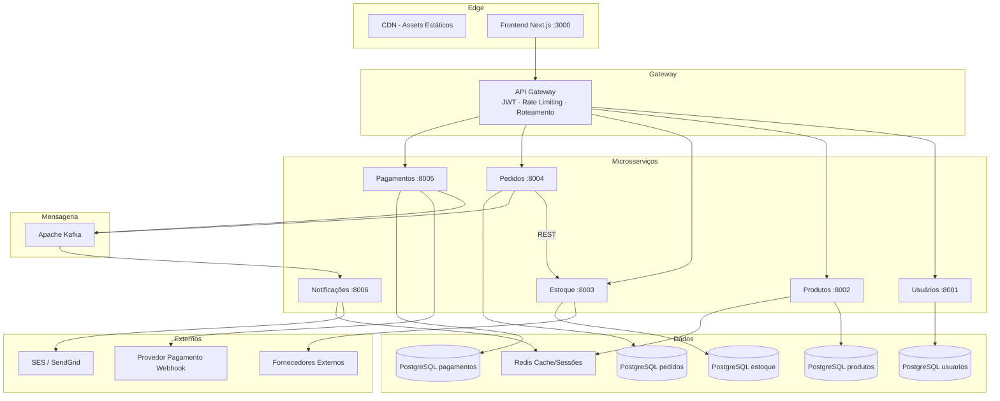

---

## 3. Domain Storytelling

**Fluxo principal — Checkout:**

1. O **Cliente** acessa o **Frontend** e verifica disponibilidade de produtos.
2. O **Frontend** consulta o **Serviço de Produtos**, que consulta o **Serviço de Estoque** para retornar apenas produtos disponíveis.
3. O **Serviço de Estoque**, sem quantidade local, consulta **Fornecedores externos** como fallback.
4. O **Serviço de Produtos** recomenda produtos disponíveis ao **Frontend**.
5. O **Cliente** seleciona produtos, formando o carrinho.
6. O **Cliente** finaliza a compra; o **Frontend** envia o pedido ao **Serviço de Pedidos**.
7. O **Serviço de Pedidos** cria o pedido com status **PENDENTE** e solicita reserva ao **Serviço de Estoque**.
8. O **Frontend** inicia sessão de pagamento no **Serviço de Pagamentos**.
9. O **Cliente** informa dados de pagamento.
10. O **Serviço de Pagamentos** aciona o **Provedor Externo**, que retorna resultado via **webhook**.
11. O **Serviço de Pagamentos** publica evento `pagamento.confirmado` ou `pagamento.recusado` no **Kafka**.
12. O **Serviço de Pedidos** consome o evento e atualiza o status.
13. O **Serviço de Notificações** consome o evento e envia e-mail ao **Cliente**.

---

## 4. Fluxo de Dados — Sequência de Checkout

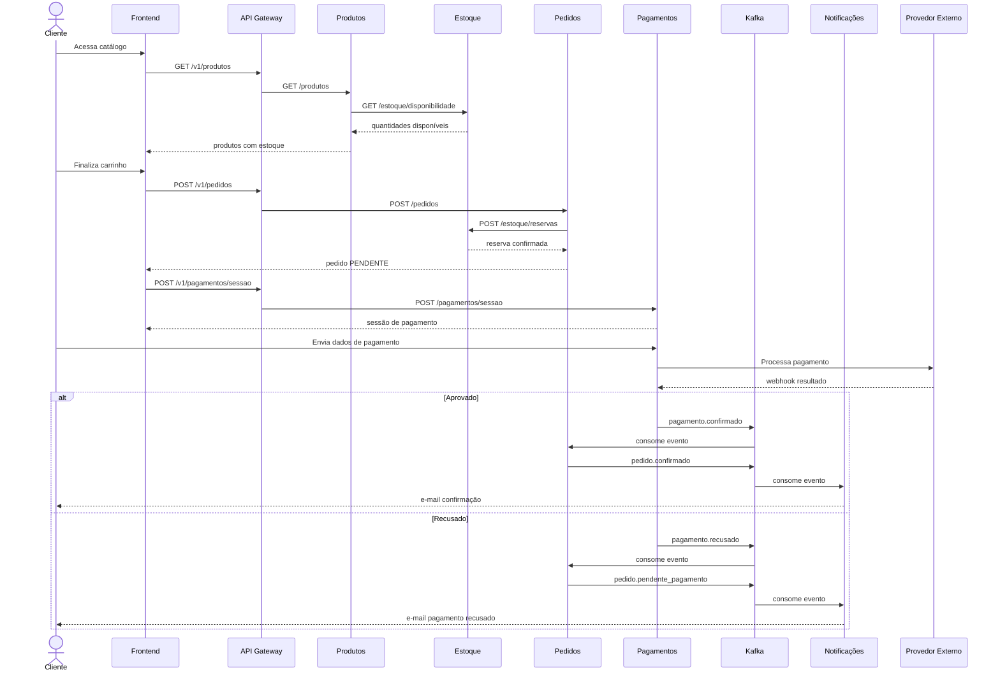


---

## 5. Componentes do Frontend

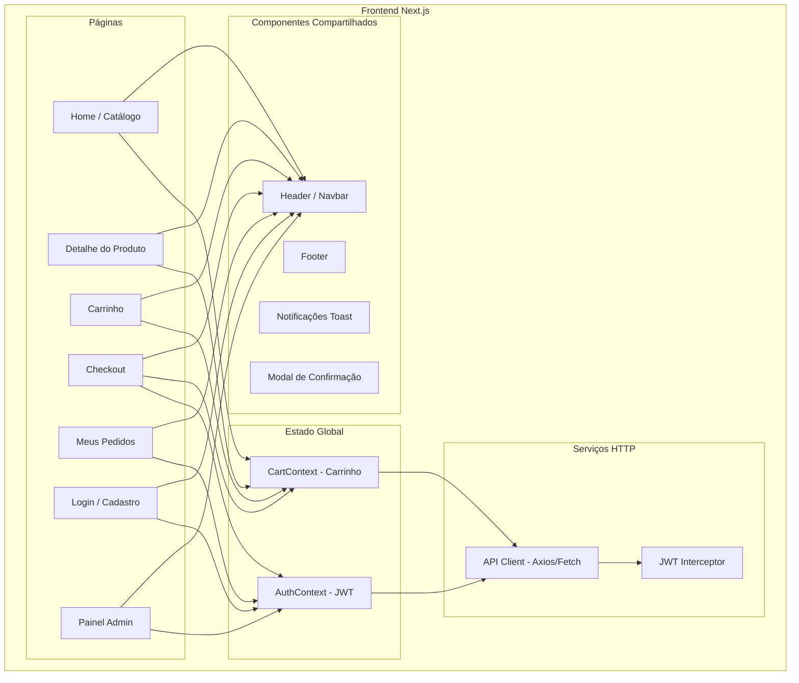

---

## 6. Componentes dos Microsserviços (Arquitetura Hexagonal)

### 6.1 Padrão Hexagonal aplicado a cada serviço

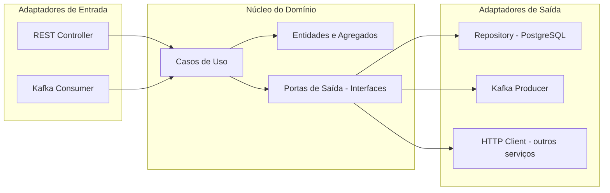

### 6.2 Serviço de Usuários

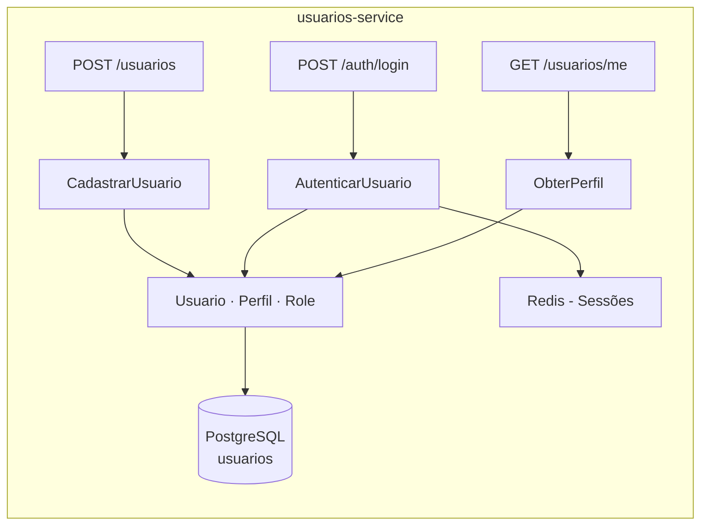

### 6.3 Serviço de Produtos

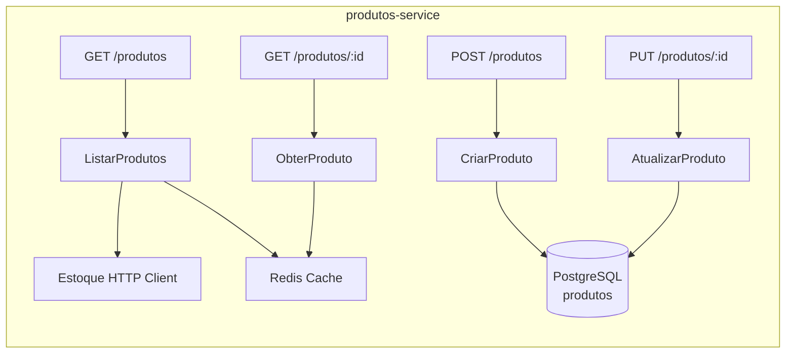

### 6.4 Serviço de Estoque

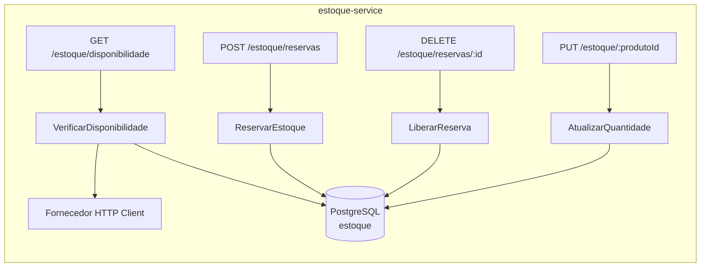

### 6.5 Serviço de Pedidos

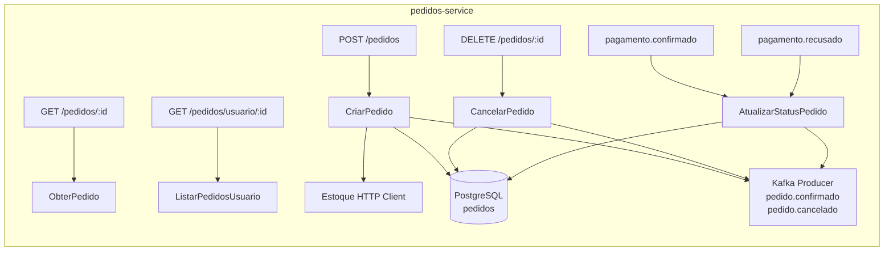

### 6.6 Serviço de Pagamentos

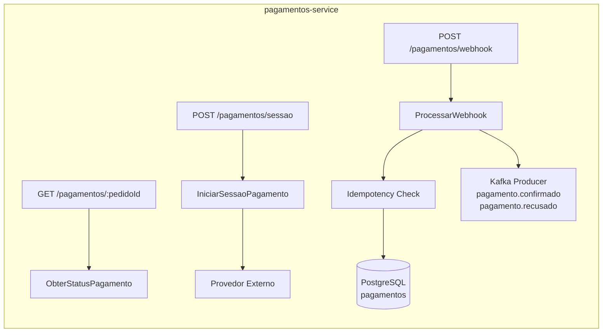

### 6.7 Serviço de Notificações

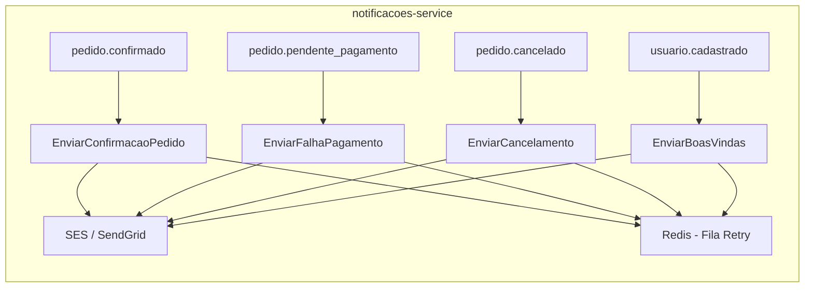


---

## 7. Topologia de Implantação — Alta Disponibilidade com Contêineres

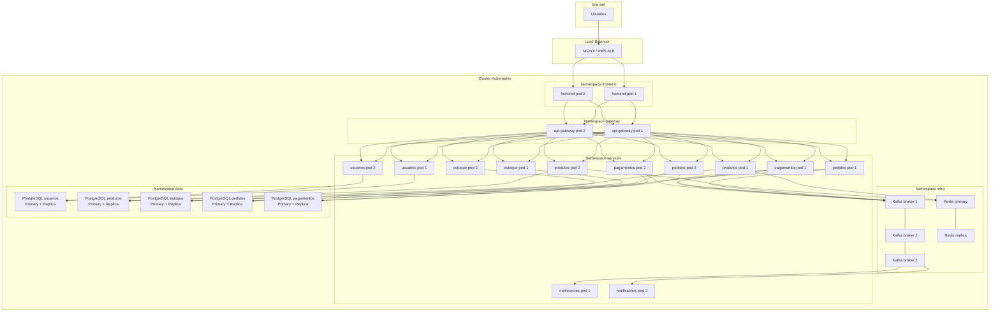

---

## 8. Principais Endpoints REST por Microsserviço

### Serviço de Usuários (`/v1/usuarios`)
| Método | Endpoint | Descrição | Auth |
|---|---|---|---|
| POST | `/v1/usuarios` | Cadastrar novo usuário | Público |
| POST | `/v1/auth/login` | Autenticar e obter JWT | Público |
| GET | `/v1/usuarios/me` | Obter perfil do usuário logado | JWT |
| PUT | `/v1/usuarios/me` | Atualizar perfil | JWT |
| POST | `/v1/auth/refresh` | Renovar token JWT | JWT |

### Serviço de Produtos (`/v1/produtos`)
| Método | Endpoint | Descrição | Auth |
|---|---|---|---|
| GET | `/v1/produtos` | Listar produtos (paginado, filtros) | Público |
| GET | `/v1/produtos/:id` | Detalhe do produto | Público |
| POST | `/v1/produtos` | Criar produto | ADMIN |
| PUT | `/v1/produtos/:id` | Atualizar produto | ADMIN |
| DELETE | `/v1/produtos/:id` | Remover produto | ADMIN |

### Serviço de Estoque (`/v1/estoque`)
| Método | Endpoint | Descrição | Auth |
|---|---|---|---|
| GET | `/v1/estoque/disponibilidade` | Verificar disponibilidade (lista de IDs) | Interno |
| POST | `/v1/estoque/reservas` | Reservar itens para pedido | Interno |
| DELETE | `/v1/estoque/reservas/:reservaId` | Liberar reserva | Interno |
| PUT | `/v1/estoque/:produtoId` | Atualizar quantidade | ADMIN/OPERADOR |

### Serviço de Pedidos (`/v1/pedidos`)
| Método | Endpoint | Descrição | Auth |
|---|---|---|---|
| POST | `/v1/pedidos` | Criar pedido (checkout) | JWT |
| GET | `/v1/pedidos/:id` | Obter pedido por ID | JWT |
| GET | `/v1/pedidos` | Listar pedidos do usuário logado | JWT |
| DELETE | `/v1/pedidos/:id` | Cancelar pedido | JWT |
| GET | `/v1/admin/pedidos` | Listar todos os pedidos | ADMIN |

### Serviço de Pagamentos (`/v1/pagamentos`)
| Método | Endpoint | Descrição | Auth |
|---|---|---|---|
| POST | `/v1/pagamentos/sessao` | Iniciar sessão de pagamento | JWT |
| POST | `/v1/pagamentos/webhook` | Receber resultado do provedor | Assinatura HMAC |
| GET | `/v1/pagamentos/:pedidoId` | Status do pagamento | JWT |

---

## 9. Modelos de Dados por Microsserviço

### 9.1 Serviço de Usuários

```sql
-- Tabela: usuarios
CREATE TABLE usuarios (
    id          UUID PRIMARY KEY DEFAULT gen_random_uuid(),
    nome        VARCHAR(150) NOT NULL,
    email       VARCHAR(255) UNIQUE NOT NULL,
    senha_hash  VARCHAR(255) NOT NULL,       -- bcrypt custo 12
    role        VARCHAR(20) NOT NULL DEFAULT 'CLIENTE', -- CLIENTE | OPERADOR | ADMIN
    ativo       BOOLEAN NOT NULL DEFAULT true,
    criado_em   TIMESTAMP NOT NULL DEFAULT NOW(),
    atualizado_em TIMESTAMP NOT NULL DEFAULT NOW()
);
```

### 9.2 Serviço de Produtos

```sql
-- Tabela: categorias
CREATE TABLE categorias (
    id    UUID PRIMARY KEY DEFAULT gen_random_uuid(),
    nome  VARCHAR(100) NOT NULL
);

-- Tabela: produtos
CREATE TABLE produtos (
    id           UUID PRIMARY KEY DEFAULT gen_random_uuid(),
    categoria_id UUID REFERENCES categorias(id),
    nome         VARCHAR(255) NOT NULL,
    descricao    TEXT,
    preco        NUMERIC(12,2) NOT NULL,
    imagem_url   VARCHAR(500),
    ativo        BOOLEAN NOT NULL DEFAULT true,
    criado_em    TIMESTAMP NOT NULL DEFAULT NOW(),
    atualizado_em TIMESTAMP NOT NULL DEFAULT NOW()
);
```

### 9.3 Serviço de Estoque

```sql
-- Tabela: estoque
CREATE TABLE estoque (
    id          UUID PRIMARY KEY DEFAULT gen_random_uuid(),
    produto_id  UUID NOT NULL UNIQUE,   -- FK lógica → produtos.id
    quantidade  INTEGER NOT NULL DEFAULT 0,
    atualizado_em TIMESTAMP NOT NULL DEFAULT NOW()
);

-- Tabela: reservas
CREATE TABLE reservas (
    id          UUID PRIMARY KEY DEFAULT gen_random_uuid(),
    pedido_id   UUID NOT NULL,          -- FK lógica → pedidos.id
    produto_id  UUID NOT NULL,          -- FK lógica → produtos.id
    quantidade  INTEGER NOT NULL,
    expira_em   TIMESTAMP NOT NULL,     -- TTL 15 minutos
    status      VARCHAR(20) NOT NULL DEFAULT 'ATIVA', -- ATIVA | CONFIRMADA | LIBERADA
    criado_em   TIMESTAMP NOT NULL DEFAULT NOW()
);
```

### 9.4 Serviço de Pedidos

```sql
-- Tabela: pedidos
CREATE TABLE pedidos (
    id           UUID PRIMARY KEY DEFAULT gen_random_uuid(),
    usuario_id   UUID NOT NULL,         -- FK lógica → usuarios.id
    status       VARCHAR(30) NOT NULL DEFAULT 'PENDENTE',
                 -- PENDENTE | CONFIRMADO | CANCELADO | ENTREGUE
    total        NUMERIC(12,2) NOT NULL,
    criado_em    TIMESTAMP NOT NULL DEFAULT NOW(),
    atualizado_em TIMESTAMP NOT NULL DEFAULT NOW()
);

-- Tabela: itens_pedido
CREATE TABLE itens_pedido (
    id          UUID PRIMARY KEY DEFAULT gen_random_uuid(),
    pedido_id   UUID NOT NULL REFERENCES pedidos(id),
    produto_id  UUID NOT NULL,          -- FK lógica → produtos.id
    nome_produto VARCHAR(255) NOT NULL, -- snapshot no momento da compra
    preco_unit  NUMERIC(12,2) NOT NULL, -- snapshot no momento da compra
    quantidade  INTEGER NOT NULL
);
```

### 9.5 Serviço de Pagamentos

```sql
-- Tabela: pagamentos
CREATE TABLE pagamentos (
    id              UUID PRIMARY KEY DEFAULT gen_random_uuid(),
    pedido_id       UUID NOT NULL UNIQUE,  -- FK lógica → pedidos.id
    idempotency_key VARCHAR(255) UNIQUE NOT NULL,
    status          VARCHAR(20) NOT NULL DEFAULT 'PENDENTE',
                    -- PENDENTE | APROVADO | RECUSADO
    provedor        VARCHAR(50),
    referencia_ext  VARCHAR(255),          -- ID no provedor externo
    valor           NUMERIC(12,2) NOT NULL,
    criado_em       TIMESTAMP NOT NULL DEFAULT NOW(),
    atualizado_em   TIMESTAMP NOT NULL DEFAULT NOW()
);
```

### 9.6 Serviço de Notificações

```json
// Documento Redis (fila de retry) — chave: notif:{uuid}
{
  "id": "uuid",
  "tipo": "PEDIDO_CONFIRMADO | PAGAMENTO_RECUSADO | PEDIDO_CANCELADO | BOAS_VINDAS",
  "destinatario_email": "usuario@email.com",
  "destinatario_nome": "Nome do Usuário",
  "payload": {
    "pedido_id": "uuid",
    "total": 199.90,
    "itens": [{ "nome": "Produto X", "quantidade": 2 }]
  },
  "tentativas": 0,
  "criado_em": "2026-10-14T09:00:00Z"
}
```

---

## 10. Foreign Keys entre Microsserviços (FK Lógicas)

Em arquitetura de microsserviços, não existem FK físicas entre bancos distintos. As referências são **FK lógicas** — IDs armazenados sem constraint de banco, com consistência garantida pela aplicação e pelo padrão SAGA.

| Serviço Origem | Campo | Referência Lógica | Serviço Destino |
|---|---|---|---|
| estoque.estoque | `produto_id` | produtos.id | Produtos |
| estoque.reservas | `produto_id` | produtos.id | Produtos |
| estoque.reservas | `pedido_id` | pedidos.id | Pedidos |
| pedidos.pedidos | `usuario_id` | usuarios.id | Usuários |
| pedidos.itens_pedido | `produto_id` | produtos.id | Produtos |
| pagamentos.pagamentos | `pedido_id` | pedidos.id | Pedidos |


---

## 11. Padrão SAGA — Transações Distribuídas

O fluxo de checkout envolve múltiplos serviços e requer consistência eventual. Adota-se o padrão **SAGA Coreografado** (via eventos Kafka), onde cada serviço reage a eventos e publica o próximo.

### 11.1 SAGA de Checkout — Fluxo Feliz

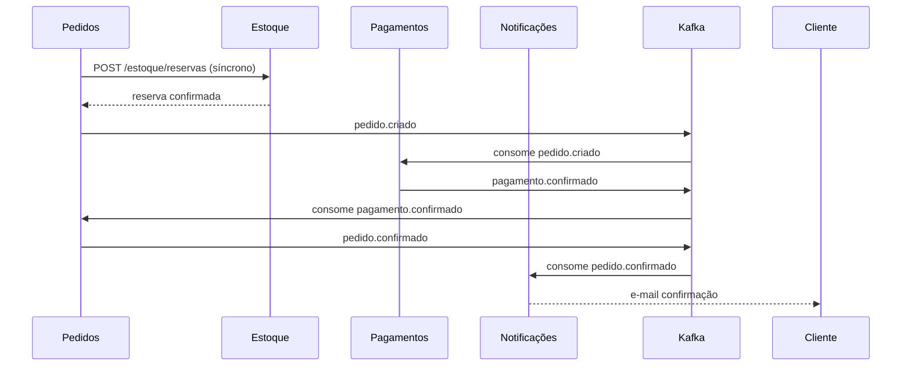

### 11.2 SAGA de Checkout — Compensação (Pagamento Recusado)

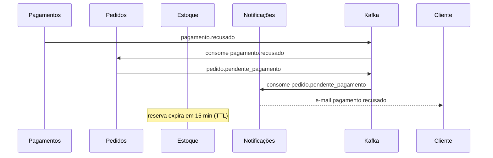

### 11.3 SAGA de Cancelamento — Compensação

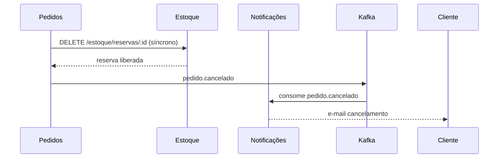

### 11.4 Tópicos Kafka

| Tópico | Produtor | Consumidor | Descrição |
|---|---|---|---|
| `pagamento.confirmado` | Pagamentos | Pedidos | Pagamento aprovado pelo provedor |
| `pagamento.recusado` | Pagamentos | Pedidos, Notificações | Pagamento recusado pelo provedor |
| `pedido.confirmado` | Pedidos | Notificações | Pedido confirmado após pagamento |
| `pedido.pendente_pagamento` | Pedidos | Notificações | Pedido aguardando nova tentativa |
| `pedido.cancelado` | Pedidos | Notificações, Estoque | Pedido cancelado pelo cliente |
| `usuario.cadastrado` | Usuários | Notificações | Novo usuário cadastrado |

---

## 12. Cenários de Teste BDD — Gherkin

### FUNC-01 — Cadastro de Usuário
```gherkin
Funcionalidade: Cadastro de usuário

  Cenário: Cadastro com sucesso
    Dado que o e-mail "novo@email.com" não está cadastrado
    Quando o usuário preencher nome, e-mail e senha válidos
    E submeter o formulário de cadastro
    Então a conta deve ser criada com sucesso
    E um e-mail de boas-vindas deve ser enviado em até 1 minuto

  Cenário: E-mail já cadastrado
    Dado que o e-mail "existente@email.com" já está cadastrado
    Quando o usuário tentar se cadastrar com o mesmo e-mail
    Então o sistema deve retornar erro 409
    E sugerir recuperação de senha
```

### FUNC-02 — Autenticação
```gherkin
Funcionalidade: Autenticação de usuário

  Cenário: Login com sucesso
    Dado que o usuário possui conta ativa
    Quando informar e-mail e senha corretos
    Então deve receber um token JWT válido com expiração de 1 hora

  Cenário: Bloqueio após tentativas falhas
    Dado que o usuário informou credenciais inválidas 5 vezes consecutivas
    Quando tentar fazer login novamente
    Então o sistema deve bloquear o acesso por 15 minutos
    E retornar erro 429
```

### FUNC-03 — Consulta de Catálogo
```gherkin
Funcionalidade: Consulta de produtos

  Cenário: Listagem de produtos disponíveis
    Dado que existem produtos cadastrados com estoque
    Quando o cliente acessar o catálogo sem autenticação
    Então deve receber a lista de produtos com status de disponibilidade
    E o tempo de resposta deve ser inferior a 500ms

  Cenário: Produto sem estoque exibido como indisponível
    Dado que o produto "X" possui quantidade zero no estoque
    Quando o cliente acessar o catálogo
    Então o produto "X" deve aparecer como indisponível
    E produtos similares devem ser sugeridos
```

### FUNC-04 — Gerenciamento de Carrinho
```gherkin
Funcionalidade: Carrinho de compras

  Cenário: Adicionar produto ao carrinho
    Dado que o cliente está autenticado
    E o produto possui estoque disponível
    Quando o cliente adicionar o produto ao carrinho
    Então o item deve aparecer no carrinho com a quantidade selecionada

  Cenário: Quantidade limitada ao estoque
    Dado que o produto possui apenas 3 unidades em estoque
    Quando o cliente tentar adicionar 5 unidades
    Então o sistema deve limitar a quantidade a 3
    E exibir mensagem informando a quantidade máxima disponível
```

### FUNC-05 — Criação de Pedido (Checkout)
```gherkin
Funcionalidade: Criação de pedido

  Cenário: Checkout com estoque disponível
    Dado que o cliente está autenticado
    E possui itens no carrinho com estoque disponível
    Quando finalizar a compra
    Então um pedido deve ser criado com status PENDENTE
    E o estoque deve ser reservado atomicamente
    E uma sessão de pagamento deve ser iniciada

  Cenário: Estoque esgotado no momento do checkout
    Dado que o produto ficou sem estoque após ser adicionado ao carrinho
    Quando o cliente tentar finalizar a compra
    Então o pedido não deve ser criado
    E o cliente deve ser notificado sobre a indisponibilidade
```

### FUNC-06 — Processamento de Pagamento
```gherkin
Funcionalidade: Processamento de pagamento

  Cenário: Pagamento aprovado via webhook
    Dado que existe um pedido PENDENTE com sessão de pagamento ativa
    Quando o provedor externo enviar webhook de aprovação
    Então o pedido deve ser atualizado para CONFIRMADO
    E o evento pagamento.confirmado deve ser publicado no Kafka

  Cenário: Pagamento recusado
    Dado que o cliente iniciou o pagamento
    Quando o provedor retornar recusa
    Então o pedido deve permanecer PENDENTE
    E o cliente deve receber notificação para nova tentativa

  Cenário: Webhook duplicado (idempotência)
    Dado que o webhook de aprovação já foi processado
    Quando o mesmo webhook for recebido novamente
    Então o sistema deve ignorar o duplicado
    E retornar 200 sem reprocessar
```

### FUNC-07 — Notificações
```gherkin
Funcionalidade: Notificações por e-mail

  Cenário: E-mail de confirmação de pedido
    Dado que o evento pedido.confirmado foi publicado
    Quando o serviço de notificações consumir o evento
    Então um e-mail de confirmação deve ser enviado ao cliente em até 1 minuto

  Cenário: Retry em caso de falha no envio
    Dado que o serviço de e-mail está indisponível
    Quando o serviço de notificações tentar enviar
    Então deve realizar até 3 tentativas com backoff exponencial
```

### FUNC-08 — Administração de Catálogo
```gherkin
Funcionalidade: Administração de catálogo e estoque

  Cenário: Admin cria produto com sucesso
    Dado que o usuário está autenticado com role ADMIN
    Quando criar um novo produto com dados válidos
    Então o produto deve aparecer no catálogo em até 5 segundos
    E a operação deve ser registrada no log de auditoria

  Cenário: Remoção bloqueada com pedidos ativos
    Dado que o produto possui pedidos com status PENDENTE ou CONFIRMADO
    Quando o admin tentar remover o produto
    Então o sistema deve bloquear a remoção
    E retornar mensagem explicativa com os pedidos ativos
```

### NAO-FUNC-01 — Performance
```gherkin
Funcionalidade: Performance do sistema

  Cenário: Tempo de resposta do catálogo
    Dado que o sistema está sob carga normal
    Quando 1000 usuários simultâneos consultarem o catálogo
    Então o percentil 95 de tempo de resposta deve ser inferior a 500ms
    E o throughput deve ser de no mínimo 500 requisições por segundo

  Cenário: Tempo de resposta do checkout
    Dado que o sistema está sob carga normal
    Quando um cliente finalizar a compra
    Então o tempo de resposta do checkout deve ser inferior a 2 segundos no p95
```

### NAO-FUNC-02 — Segurança
```gherkin
Funcionalidade: Segurança e autenticação

  Cenário: Acesso negado sem JWT
    Dado que uma requisição é feita sem token JWT
    Quando acessar endpoint protegido
    Então o sistema deve retornar 401 Unauthorized

  Cenário: Acesso negado por role insuficiente
    Dado que o usuário possui role CLIENTE
    Quando tentar acessar endpoint de ADMIN
    Então o sistema deve retornar 403 Forbidden

  Cenário: Dados de pagamento não persistidos localmente
    Dado que um pagamento é processado
    Quando verificar o banco do serviço de pagamentos
    Então dados de cartão não devem estar armazenados (PCI-DSS)
```

### NAO-FUNC-03 — Usabilidade
```gherkin
Funcionalidade: Usabilidade e acessibilidade

  Cenário: Responsividade mobile
    Dado que o usuário acessa pelo smartphone
    Quando navegar pelo catálogo e realizar checkout
    Então todos os elementos devem ser acessíveis e funcionais em tela mobile

  Cenário: Score de acessibilidade
    Dado que o frontend está em produção
    Quando executar auditoria Lighthouse
    Então o score de acessibilidade deve ser igual ou superior a 90
```

### NAO-FUNC-04 — Confiabilidade
```gherkin
Funcionalidade: Confiabilidade e tolerância a falhas

  Cenário: Falha isolada em microsserviço
    Dado que o serviço de Notificações está indisponível
    Quando um pedido for confirmado
    Então os demais serviços devem continuar funcionando normalmente
    E o circuit breaker deve abrir após 5 falhas consecutivas

  Cenário: Disponibilidade mensal
    Dado que o sistema está em produção
    Quando medida a disponibilidade no mês
    Então deve ser igual ou superior a 99,5%
```

### NAO-FUNC-05 — Observabilidade
```gherkin
Funcionalidade: Monitoramento e observabilidade

  Cenário: Logs estruturados com correlation ID
    Dado que uma requisição atravessa múltiplos serviços
    Quando verificar os logs de cada serviço
    Então todos os logs devem conter o mesmo correlation ID
    E estar em formato JSON

  Cenário: Alerta de taxa de erros
    Dado que a taxa de erros 5xx ultrapassa 1%
    Quando o sistema de monitoramento detectar a anomalia
    Então um alerta deve ser disparado para a equipe em até 1 minuto
```

### NAO-FUNC-06 — Restrições Arquiteturais
```gherkin
Funcionalidade: Restrições arquiteturais

  Cenário: Isolamento de banco de dados
    Dado que o serviço de Pedidos precisa de dados de Produtos
    Quando consultar informações de produto
    Então deve fazê-lo via API REST do serviço de Produtos
    E nunca acessar diretamente o banco de dados de Produtos

  Cenário: Eventos publicados no broker
    Dado que um pedido é confirmado
    Quando o status for atualizado
    Então o evento pedido.confirmado deve ser publicado no Kafka
    E não via chamada direta ao serviço de Notificações
```

---

## 13. Decisões Técnicas e Justificativas

| Decisão | Tecnologia | Justificativa | Custo vs Benefício |
|---|---|---|---|
| Framework Frontend | Next.js (React) | SSR para SEO, roteamento nativo, ecossistema maduro | Open source; curva de aprendizado moderada |
| API Gateway | Kong / NGINX | Rate limiting, autenticação JWT centralizada, open source | Sem custo de licença; requer configuração |
| Broker de Mensagens | Apache Kafka | Alta throughput, retenção de eventos, replay | Open source; operação mais complexa que SQS |
| Banco de Dados | PostgreSQL | ACID, maturidade, suporte a JSON, open source | Sem custo de licença; requer DBA |
| Cache | Redis | Sub-milissegundo, estruturas de dados ricas, fila de retry | Open source; memória volátil requer persistência |
| Observabilidade | Prometheus + Grafana + Jaeger | Stack completa open source, padrão de mercado | Sem custo de licença; requer infraestrutura |
| Orquestração | Kubernetes | Auto-scaling, self-healing, padrão de mercado | Open source; complexidade operacional alta |
| Autenticação | JWT + bcrypt | Stateless, escalável, sem sessão centralizada | Sem custo; risco de token roubado (mitigado com expiração curta) |
| Padrão de Transação | SAGA Coreografado | Sem ponto central de falha, desacoplado | Maior complexidade de rastreamento; mitigado com tracing distribuído |
| Arquitetura por Serviço | Hexagonal | Testabilidade, troca de adaptadores sem impacto no domínio | Mais código inicial; ganho em manutenibilidade |

---

## 14. Referências às Decisões de Requisitos

| Decisão Arquitetural | Requisito de Origem |
|---|---|
| Database per Service | NAO-FUNC-06 |
| Circuit Breaker entre serviços | NAO-FUNC-04 |
| JWT com expiração 1h + RBAC | NAO-FUNC-02, FUNC-02 |
| Idempotency key no webhook | FUNC-06, RISCO-02 |
| SAGA para checkout | FUNC-05, RISCO-01 |
| Redis TTL 15min para reservas | FUNC-05, RN-03 |
| Kafka para eventos de domínio | NAO-FUNC-06, FUNC-07 |
| Snapshot de preço em itens_pedido | RN-02, FUNC-05 |
| Retry com backoff exponencial | FUNC-07, DEP-02 |
| Logs JSON com correlation ID | NAO-FUNC-05 |

---

*Documento gerado por: Arquiteto de Software (Amazon Q)*
*Data: 2026-10-14 | Versão: 1.0*
